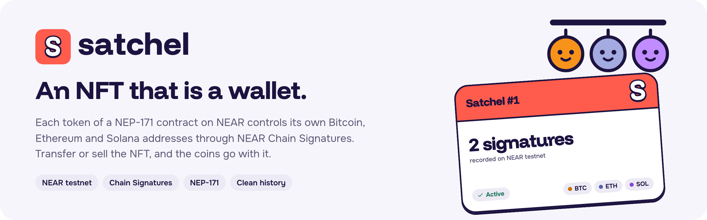
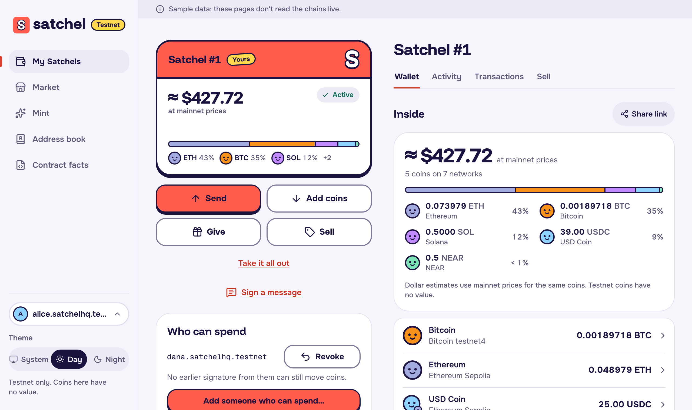
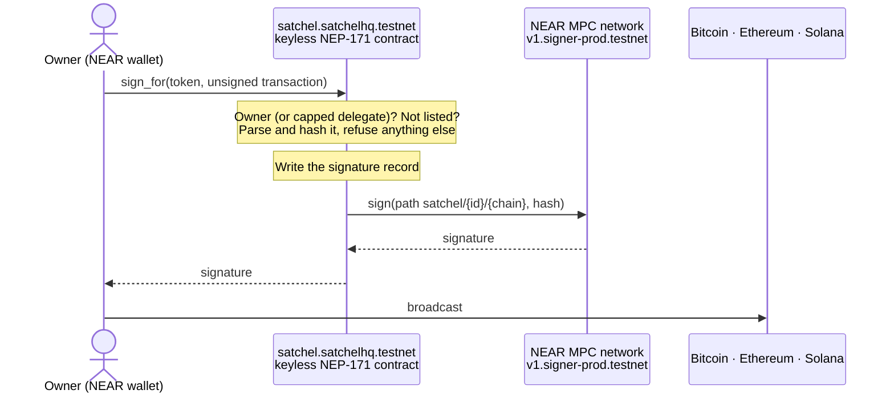
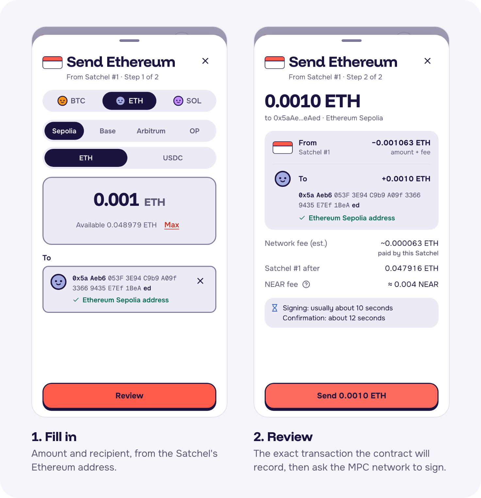
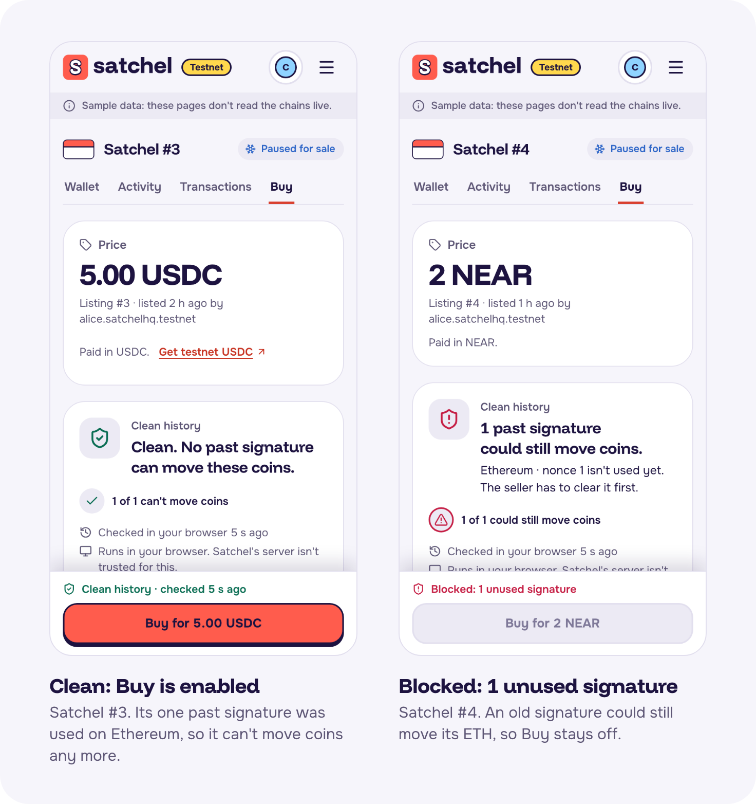
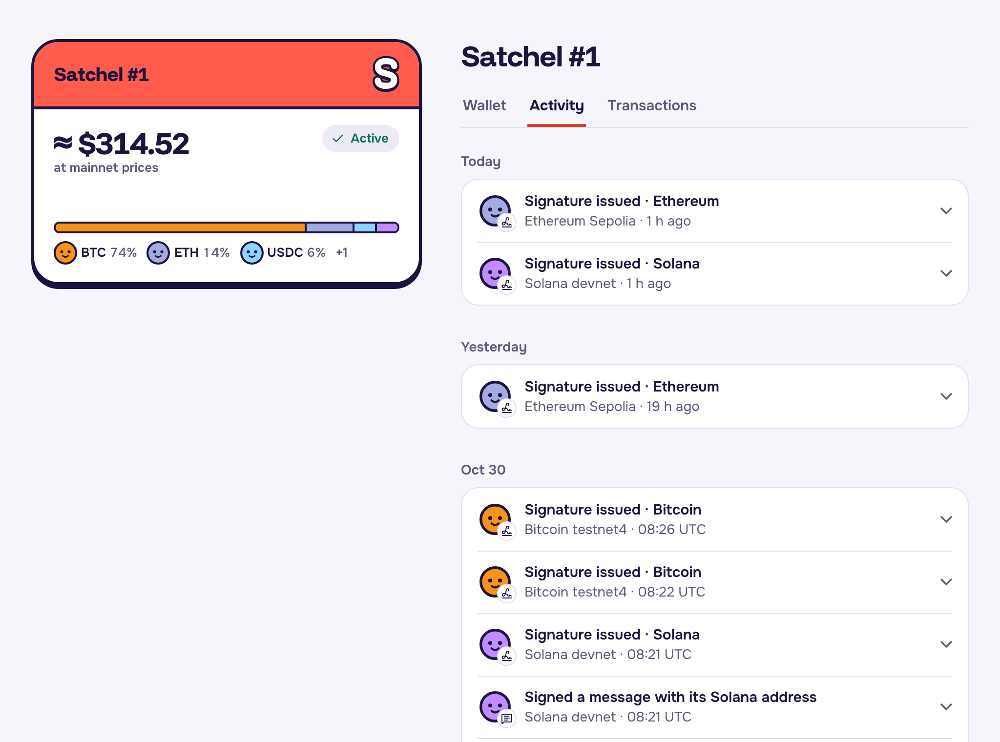

<p align="center">
  
</p>

# Satchel: an NFT that is a wallet

Satchel is a NEP-171 NFT contract on NEAR testnet. Each token controls its own native Bitcoin, Ethereum and Solana
addresses through NEAR Chain Signatures. Transfer or sell the NFT and you hand over the wallet: no bridge, no wrapped
token, no seed phrase.

Built for NEAR HACKATHON (Nov 1–14, 2026), tracks `nfts` and `open`, by Razvan Statescu (solo).
**Testnet only: the coins have no value.**

<p align="center">
  <a href="https://usesatchel.xyz"><b>Live app</b></a> ·
  <a href="#try-it-in-60-seconds-no-wallet-no-install">Try it</a> ·
  <a href="docs/how-it-works.md">How it works</a> ·
  <a href="docs/near.md">NEAR features</a> ·
  <a href="docs/verify.md">Verify on-chain</a> ·
  <a href="AGENTS.md">Guide for AI reviewers</a>
</p>

<p align="center">
  
  <br><sub>The owner's view of a Satchel. Screens use the app's built-in sample data unless the caption says live.</sub>
</p>

## The problem

A wallet's keys cannot be sold safely: whoever held the seed phrase can keep a copy. An NFT that controls keys
fixes that, because the contract signs only for the current owner. But it leaves one hole: a signature made
**before** a sale can still be broadcast **after** it. A buyer needs proof that no old signature can still move the
coins, and no NFT-wallet design we know of provides it.

**Satchel closes the hole:**
1. The contract records every signature **before** it asks NEAR's MPC network to sign.
2. Signing freezes while a Satchel is listed for sale.
3. The buyer's browser checks every record on its own chain ("clean history"). Buy stays disabled until each one is
   provably used up or expired.

## Try it in 60 seconds (no wallet, no install)

> The app reads the development contract `dev2.satchelhq.testnet` until the final contract
> `satchel.satchelhq.testnet` is born keyless on **Nov 10**. Values marked `[TBD: …]` exist from then on.

| Do | See |
|---|---|
| Open https://usesatchel.xyz/s/1 | The owner, the three addresses (BTC `tb1qtf95jlrryxd2kfrs2ug03p4awlwwm2wfrjcwy5`, ETH `0xD0CdbF830B82FaBf6aee04D1a2633A51F6b2d5ad`, SOL `AGSUq86qgpp1eB53UaL8iRscRjJzsQfrNKsKoxPXTXTd` on the final contract), live balances and the signature count. Server-rendered, so it reads the same with JavaScript off |
| `curl -s https://usesatchel.xyz/api/satchels/1` | The same facts as JSON: `owner`, `addresses`, `balances`, `sig_count`, `listing`, `status` |
| `curl -s https://usesatchel.xyz/api/clean-history/1` | The clean-history check for Satchel #1 as JSON, computed by the server from live chain data: each signature record, what it names (nonce, coin or blockhash), whether it can still move coins, and the overall verdict. Labelled a hint: only the buyer's browser can turn Buy on |
| Open https://usesatchel.xyz/market | Each listing with its clean-history verdict. On the final contract, demo Satchel #4 is blocked on purpose ([why](docs/security-model.md#demo-token-4-is-blocked-on-purpose)) |
| Open https://usesatchel.xyz/contract | The lock facts: no access keys, the birth transaction `[TBD]`, the code hash `[TBD: H]` and the MPC version |
| With a testnet wallet (Meteor or Intear), open `/mint` | A new Satchel with three fresh addresses. Fund one from a faucet, then use Send |

A Satchel's addresses depend only on the contract and the path `satchel/{id}/{btc|evm|sol}`, so they never change
when the NFT changes hands.

## How it works

The owner asks the contract to sign an unsigned transaction. The contract checks it, records it, and only then asks
NEAR's MPC network for the signature:



<p align="center">
  
</p>

The contract accepts only plain transfers and plain-text messages, and hashes them itself. It never signs a raw hash,
so its record always says exactly what was signed. Details, the buying flow and every feature:
[docs/how-it-works.md](docs/how-it-works.md).

## When a Satchel changes hands

Ownership moves in three places only: `nft_transfer` (a gift), `buy` (NEAR, or USDC through `ft_on_transfer`) and
`accept_offer`. Each is a single receipt, so there is no moment when both people, or neither, control the Satchel. In
that receipt the contract:

1. moves the NEP-171 token to the new owner;
2. clears every spending allowance the old owner granted;
3. ends the listing, if there is one, and starts paying the seller;
4. keeps the NEAR, USDC and wNEAR held inside the Satchel, and its signature records, with the token.

Nothing else has to change, because the old owner never had a key. Each address belongs to a key that NEAR's MPC
network derives from (this contract, `satchel/{id}/{chain}`). The MPC signs for that path only when the contract asks,
and the contract asks only from `sign_for`, which checks the caller against the current owner on every call. So from
the receipt of the hand-off on:

| The old owner tries to… | What happens |
|---|---|
| Sign with the Satchel | `sign_for` refuses: not the owner |
| Keep spending through a delegate they added | The allowance was cleared in the same receipt |
| Withdraw the NEAR, USDC or wNEAR inside it | Refused: not the owner |
| List it, give it or accept an offer for it | Refused: not the owner |
| Use a copy of the key or a seed phrase | There is none. No key exists outside the MPC network, and the contract account has no key either |

What the old owner can still hold is a signature made **before** the hand-off. That is what the rest of the design is
for: the record is written before every signature, signing freezes while a Satchel is listed, and the buyer's browser
checks every record before Buy turns on (next section). Paying the seller is detached from the hand-off: if the
payment fails, the buyer still gets the Satchel and the money waits in the seller's `proceeds_of`.

Every row above is tested on each of the four ownership paths, against the compiled contract in a local sandbox:
[`tests/tests/transfer_path.rs`](tests/tests/transfer_path.rs) `old_owner_loses_every_power_on_every_ownership_path`.
The same file resells a Satchel while the first sale's payment is still in flight, and after it failed, and checks
that each seller is paid exactly once and that nobody else is credited.

## Buying safely

<p align="center">
  
  <br><sub>Left: every past signature is used up, so Buy is enabled. Right: one could still move the coins, so Buy stays off.</sub>
</p>

The check runs in the buyer's browser, not on Satchel's server. The purchase then names the listing and the number
of records the buyer checked, and fails if either has changed. Every way a seller could try to keep the coins, and
the test that stops each one: [docs/selling.md](docs/selling.md). The full threat model also covers the money held
inside a Satchel, the buyer's payment, offers and claim links: [docs/security/seller-threat-model.md](docs/security/seller-threat-model.md).

## Built on NEAR

| Track hint | How Satchel uses it |
|---|---|
| `open` · **CHAIN ABSTRACTION** | NEAR Chain Signatures signs native Bitcoin, Ethereum (Sepolia, Base, Arbitrum, OP) and Solana transactions for each token, from one NEAR contract |
| `nfts` · **NEP-171** | The wallet is an ordinary NEP-171 token (plus NEP-177, NEP-181, NEP-297 events). Transferring it hands over the coins |
| `nfts` · **DYNAMIC NFTS** | The token's image is drawn from contract state: its status and how many signatures it has issued. The contract's `base_uri` points at the app, which renders the card from that state (`/api/card/{id}.svg`) |
| `nfts` · **SUB-ACCOUNTS** | The contract is the sub-account `satchel.satchelhq.testnet`, born in one transaction with no access key, so its code can never change. The tokens are not sub-accounts: each one's addresses are derived under that one account |
| `open` · **EXPERIMENTAL** | Clean history: records written before signing, a freeze while listed, a buy bound to the checked history |
| also | NEP-141 for USDC and wNEAR payments and deposits; NEP-330 source metadata; FastNEAR RPC and transactions API; near-connect wallets |

How each one is used, with links to the code: [docs/near.md](docs/near.md).

## What you can do

Mint a Satchel · add coins (anyone can) · send BTC, ETH, USDC or SOL · sign a message · give it away, directly or by
a claim link · sell it for NEAR or USDC · make or accept offers · let someone spend within a daily cap · hold NEAR,
USDC and wNEAR inside it · empty it in one go · read its full history.

<p align="center">
  
  <br><sub>Live: Satchel #1's history, every signature it has issued, read from the contract.</sub>
</p>

Each flow with its app route and contract method: [docs/how-it-works.md](docs/how-it-works.md#what-a-satchel-can-do).

## Verify it yourself

Every on-chain claim has a read-only command. One script runs them all and compares the output (it needs `bash`,
`curl` and `python3`):

```sh
tools/judge-snippets.sh            # runs every check against testnet
tools/judge-snippets.sh --print    # lists the commands without running them
```

It checks who owns Satchel #1, that the contract has no access keys and runs this repository's code (reproducible
build), that its birth transaction had no AddKey, that it has never signed a transaction itself, its constants and
the MPC it depends on, and it prints the balances of #1's addresses to compare with the app. Each command with its expected output:
[docs/verify.md](docs/verify.md).

## Run it locally

```sh
pnpm install --frozen-lockfile
pnpm --filter web dev                       # http://localhost:3000, with sample data
cargo test -p satchel --lib                 # contract unit tests, offline
```

Every test suite, what it covers, and the testnet scripts (dry run by default): [docs/development.md](docs/development.md).

## Security and limits

- **The MPC network is trusted.** A threshold of its nodes could sign anything.
- **The contract cannot see other chains,** so the clean-history check runs in the buyer's browser and trusts public
  data providers (two each for Bitcoin and Ethereum).
- **Testnet only,** with testnet-grade confirmation depth. A mainnet version would need an audit.
- **Immutable by design.** A bug means a new contract with new addresses.

What the check proves, what it trusts and what it does not cover:
[docs/security-model.md](docs/security-model.md). Security reviews and fuzzing: [docs/security/](docs/security/).

## Documentation

| Read | For |
|---|---|
| [How it works](docs/how-it-works.md) | Signing, buying, and every feature with its route and contract method |
| [How Satchel uses NEAR](docs/near.md) | Chain Signatures, the NFT and token standards, the keyless account, and more |
| [Selling and the threat model](docs/selling.md) | How control passes on transfer, and every way a seller could try to keep the coins |
| [Seller threat model, in full](docs/security/seller-threat-model.md) | Every way a seller could try to keep the coins, the money held inside, or the buyer's payment: what stops each one, and its test |
| [Verify on-chain](docs/verify.md) | Copy-paste commands with expected output |
| [Security model](docs/security-model.md) | What clean history checks and trusts, and the limitations |
| [Development](docs/development.md) | Running the app, the test suites, the testnet scripts |
| [`AGENTS.md`](AGENTS.md) | For AI reviewers: reading order and each claim mapped to its code and tests |
| [`docs/README.md`](docs/README.md) | Every other document: specs, reviews, test audits, design. IDs are in the [glossary](docs/GLOSSARY.md) |
| [`kb/90-technical-spec.md`](kb/90-technical-spec.md) | The full technical specification |

**Repository:** [`contracts/`](contracts/README.md) the NEP-171 contract · [`packages/core/`](packages/core/README.md)
shared TypeScript (derivation, transaction builders, the clean-history checker) · [`apps/web/`](apps/web/README.md)
the app · [`tests/`](tests/README.md) sandbox tests · [`vectors/`](vectors/README.md) shared test vectors ·
[`tools/`](tools/README.md) scripts and judge checks. Not product code: [`research/`](research/README.md) (throwaway
spikes), [`marketing/`](marketing/README.md) (the demo video), [`plan/`](plan/README.md) (planning).

## What's next

1. An external audit, then mainnet.
2. SPL tokens on Solana.
3. Sales through third-party NEAR marketplaces, bound to a Satchel's history (the `history_digest` view already
   exists).
4. Sustainability: a small fee on sales, decided at the mainnet launch.

## Prior art

NEAR's `nft_key` showed that an NFT can own a Chain Signatures path, and House of Stake's Top Level Accounts make a
NEAR name an NFT that is also an account. Lit PKPs and Ika dWallets make keys transferable, and ERC-6551 gives NFTs
accounts on one EVM chain. Satchel combines native multichain keys with a standard NEP-171 token and adds the
buyer-verifiable clean history none of them has.

## Team

Razvan Statescu, solo builder.

## Timeline

All work falls inside the hackathon window, which counts code from the announcement on 2026-10-19 (HACKATHON.md
Q-001), so there is no baseline.
- **Oct 20–21, 2026:** research, throwaway testnet spikes (kept in [`research/`](research/README.md); no product code
  imports them), the technical specification and the brand.
- **From Oct 21, 2026:** the code in this repository, written from the specification. No spike file was copied.
- The repository was created on 2026-10-29. Earlier work is described in `plan/progress/` and `docs/handoff/`.

## Libraries, tools and AI (HACKATHON.md Q-005)

- **Contract:** near-sdk, near-contract-standards, cargo-near; near-workspaces for sandbox tests.
- **App and shared library:** Next.js, React, Tailwind CSS, near-api-js, @hot-labs/near-connect, viem, bitcoinjs-lib,
  @solana/web3.js, @noble and @scure.
- **Fonts:** Funnel Display, Onest and Geist Mono (OFL). Exact versions are in `Cargo.lock` and `pnpm-lock.yaml`.
- **No templates or boilerplate repositories.**
- **AI:** the code, tests and docs were written with AI coding agents (Claude Code) under the builder's direction.

## License

The contracts in [`contracts/`](contracts/) are **MIT** ([`contracts/LICENSE`](contracts/LICENSE)). Everything else is
**AGPL-3.0-only** ([`LICENSE`](LICENSE)). Third-party files keep their own licenses: the copies under
`research/**/vendor/` and the OFL fonts. The repository stays public through judging (Q-014).
