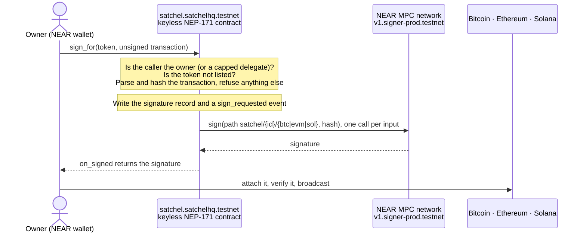
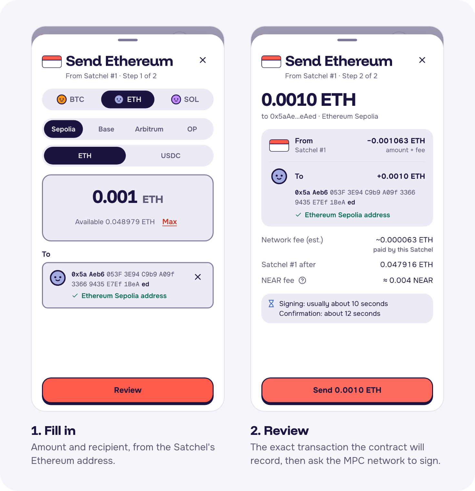
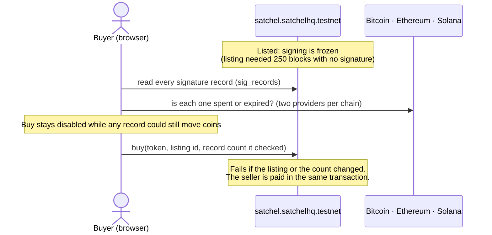
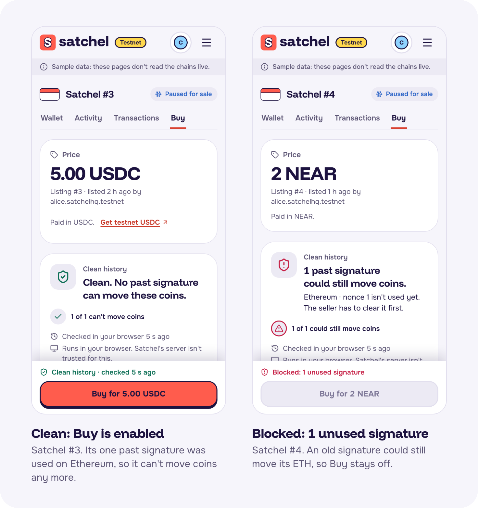
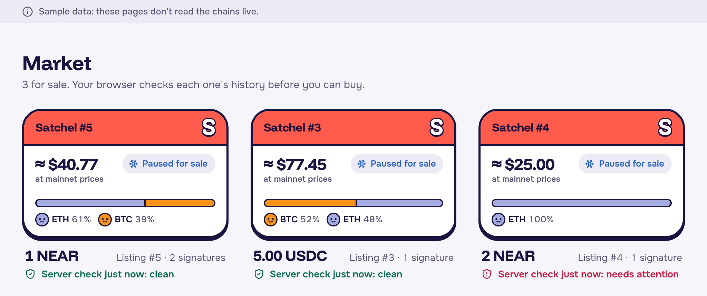

# How Satchel works

> Part of the Satchel docs. Start at the [README](../README.md); a guide for AI reviewers is in [`AGENTS.md`](../AGENTS.md).

How a Satchel signs for other chains, how a buyer checks its history before buying, and every flow the app and the contract support.

## Sending

**Sending.** The owner asks the contract to sign an unsigned transaction. The contract checks it, records it, and only
then asks NEAR's MPC network for the signature:

  
   Sending ETH from Satchel #1: fill in, then review exactly what will be signed.

- **One contract owns every key.** Token N signs at the MPC paths `satchel/N/btc`, `satchel/N/evm` (secp256k1,
  domain 0) and `satchel/N/sol` (ed25519, domain 1), with the contract as the predecessor. Only the current owner can
  call `sign_for` ([`contracts/satchel/src/sign.rs`](../contracts/satchel/src/sign.rs)), or an account the owner lets
  spend within a rolling 24-hour cap per coin and network ([`allowance.rs`](../contracts/satchel/src/allowance.rs));
  allowances end when the Satchel changes hands. Ownership moves only through `nft_transfer`
  ([`lib.rs`](../contracts/satchel/src/lib.rs)), `buy` / `ft_on_transfer` ([`sale.rs`](../contracts/satchel/src/sale.rs))
  and `accept_offer` ([`offers.rs`](../contracts/satchel/src/offers.rs)).
- **Structured payloads, never hashes.** The contract parses the exact bytes and hashes them itself:
  keccak256 for EVM, sha256d per BTC input, and the raw message for SOL. It accepts only plain ETH and USDC transfers
  on four Ethereum testnets, standard Bitcoin spends, plain SOL transfers and plain-text messages, and refuses anything
  else, including raw hashes, EIP-712 permits, EIP-7702 authorizations, any other contract call, other chains, non-ALL
  sighash types and durable nonces ([`contracts/satchel/src/parse/`](../contracts/satchel/src/parse)).
- **The record comes before the signature.** It is written in the same receipt as the MPC call, so a signature that
  arrives late or after a timeout is still on record.

## Buying: the clean-history check

**Buying.** Before Buy is enabled, the buyer's browser reads every signature the Satchel has ever issued and checks
each one on its own chain. The purchase then names exactly the history the buyer checked:

  
   The check runs in the buyer's browser. Left: every past signature is used up, so Buy is enabled. Right: one
  signature could still move the coins, so Buy stays off.

- **The sale is bound to the record count.** `list` needs 250 blocks (a couple of minutes) of signing silence. While
  listed, signing and transfers are refused. `buy(token_id, listing_id, expected_sig_count)` fails if anything
  changed. The seller is paid in the same transaction, and a failed payout is credited to `proceeds_of` instead.
- **Clean history** runs in the buyer's browser ([`packages/core/src/clean-history`](../packages/core/src/clean-history)).
  EVM: the nonce is used, read 3 blocks back on two providers. BTC: the outpoint is spent in a confirmed tx, read on
  two Esplora providers. SOL: the blockhash is expired.

  
   The market shows each listing's verdict before anyone opens it.

## What a Satchel can do

Every flow below works in the hosted app; the pages marked **SSR** render their facts in the server HTML (readable
with `curl`). Contract methods are in [`contracts/satchel/src/`](../contracts/satchel/src); the sprint features
C1–C7 are specified in [`docs/specs/`](specs/).

| What | App route | Contract |
|---|---|---|
| See a Satchel: owner, addresses, balances, signature count (**SSR**) | `/s/{id}`, `/api/satchels/{id}` | `satchel`, `sig_records` |
| Mint one | `/mint` | `nft_mint` |
| Add coins (anyone can open the link) | `/s/{id}/receive`, `/fund/{id}` | none (addresses are derived) |
| Send BTC, ETH, USDC or SOL; ETH and USDC on Sepolia, Base, Arbitrum and OP Sepolia (C2, C3) | `/s/{id}/send` | `sign_for` |
| Sign a plain-text message: EIP-191 or Solana off-chain (C7) | `/s/{id}/sign` | `sign_for` |
| Give it away, directly or by a claim link (A2) | `/s/{id}/transfer`, `/s/{id}/give-link`, `/claim` | `nft_transfer` |
| Sell it for NEAR or USDC; buy one after the clean-history check (**SSR**) | `/s/{id}/sale`, `/market` | `list`, `delist`, `buy`, `ft_on_transfer`, `withdraw_proceeds` |
| Make, accept or cancel an offer on any Satchel (C4) | `/s/{id}/offer` | `make_offer`, `accept_offer`, `cancel_offer` |
| Let another account spend up to a daily cap (C5) | `/s/{id}/allowance` | `set_allowance`, `revoke_allowance` |
| Hold NEAR, USDC or wNEAR inside the Satchel on NEAR itself (C6) | `/s/{id}/coin/{key}` | `deposit_near`, `ft_on_transfer`, `withdraw_near`, `withdraw_ft` |
| Empty it: send everything to one address per chain (A3) | `/s/{id}/empty` | `sign_for` |
| Read its history: who held it, sales, signatures and what each one signed, coins in and out (C1 adds a digest) | `/s/{id}/activity`, `/s/{id}/transactions` | `sig_records`, `history_digest` |
| Check the contract itself: lock, code hash, MPC version (**SSR**) | `/contract`, `/api/contract` | `config` |
