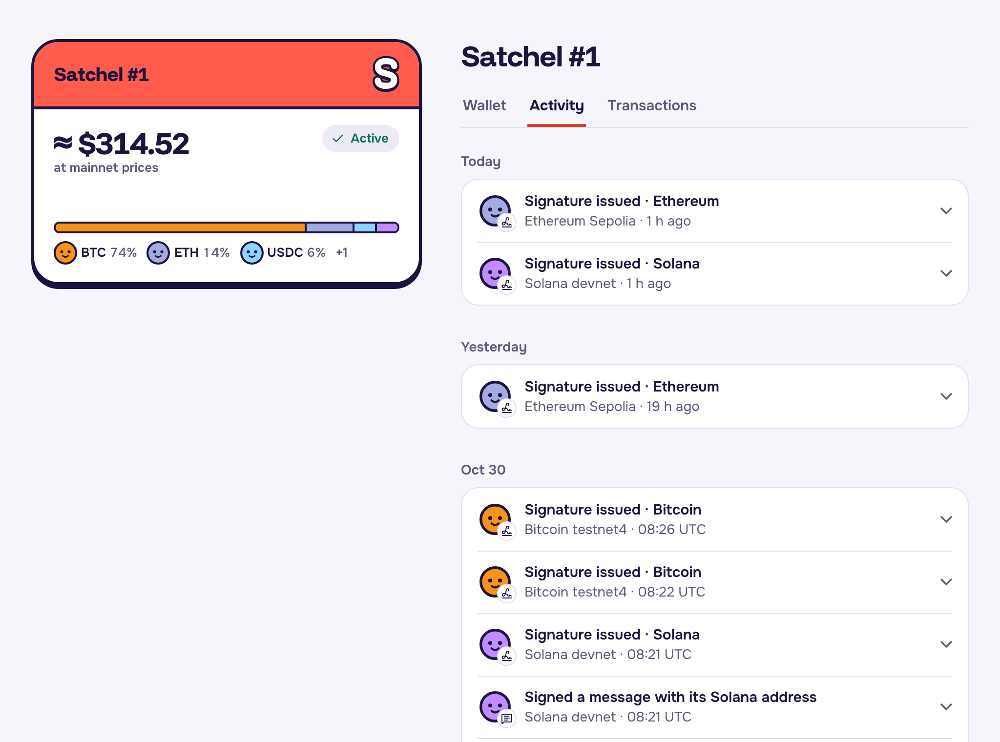

# Selling a Satchel: how control passes, and what stops the seller keeping the coins

> Part of the Satchel docs. Start at the [README](../README.md); a guide for AI reviewers is in [`AGENTS.md`](../AGENTS.md).

What changes hands when a Satchel is given, sold or bought through an offer, every way we know a seller could try to keep the coins, and the test that proves each one is stopped.

## How control passes

Ownership changes in exactly three places: `nft_transfer` (a gift), `buy` (NEAR, or USDC through `ft_on_transfer`)
and `accept_offer`. In the same receipt as the change of owner:
- `sign_for` starts accepting the new owner and stops accepting the old one;
- every allowance the old owner granted is cleared;
- the NEAR, USDC and wNEAR held inside the Satchel move with it;
- the signature records stay with the token, so the next buyer can check them too.

The old owner keeps nothing to sign with. There is no private key to copy: each address is a key the MPC network
derives for (this contract, `satchel/{id}/{chain}`), and the MPC uses it only when the contract asks. There is no
NEP-178 approval and no leftover delegate. And nobody holds a key to the contract itself (it is keyless).

## Threat model: every way we know a seller could try to keep the coins

| The seller tries to… | What stops it | Tested by |
|---|---|---|
| Keep a copy of the private key | No key exists outside the MPC network, and only the contract can ask it to sign for a token | `tests/tests/release.rs` `keyless_birth_batch`; `tools/check-wasm-imports.sh` (INV-22) |
| Keep signing after the sale | `sign_for` accepts only the current owner, or a delegate the current owner added | `tests/tests/transfer.rs` `transfer_moves_control`; `sale.rs` `buy_moves_control`; `usdc.rs` `ft_buy_moves_control` |
| Leave a delegate behind to keep spending | Every change of owner clears the allowances, and a delegate has no owner powers | `tests/tests/allowance.rs` `transfer_clears_allowances`, `sales_clear_allowances`, `delegate_has_no_owner_powers` |
| Sign a transaction before the sale and broadcast it afterwards | Every signature is recorded. The buyer's Buy button stays disabled until each record is provably spent or expired | `packages/core/test/clean-history.test.ts`; demo token #4 ([why it is blocked](security-model.md#demo-token-4-is-blocked-on-purpose)) |
| Request a signature, let the MPC time out, and hope it was not recorded | The record is written before the MPC is called, in the same receipt | `tests/tests/sign.rs` `records_written_before_mpc_call`, `timeout_never_sticks` |
| Sign while the Satchel is listed, just before the buyer clicks | Signing is frozen while listed, for the owner and delegates alike; listing needs 250 blocks without a signature | `tests/tests/sale.rs` `quiet_period_and_freeze`, `quiet_period_exact_boundary`; `allowance.rs` `listing_pauses_delegate` |
| Delist, sign, and relist between the buyer's check and the buy | `buy` names the listing id and the record count the buyer checked, and fails if either changed | `tests/tests/sale.rs` `buy_guards` |
| Sign something that is not a plain transfer but moves funds later: a raw hash, an EIP-712 permit, an ERC-20 `approve`, an EIP-7702 delegation, a Solana durable nonce, a Bitcoin sighash other than ALL | The contract parses every payload and refuses all of these | `tests/tests/sign.rs` `refusals_change_nothing_{evm,btc,sol}`; the refused cases in `vectors/*.json`; [`docs/security/fuzzing.md`](security/fuzzing.md) |
| Leave code on the Ethereum address, or hand the Solana account to a program | The buyer's check marks the Satchel unsafe | `packages/core/test/clean-history.test.ts` (the EIP-7702 and Solana-owner cases) |
| Withdraw the coins held inside the Satchel on NEAR once it is listed | Withdrawals are refused while listed, and the balances move with the token | `tests/tests/market.rs` `withdraw_blocked_while_listed`, `transfer_moves_inside`, `buy_moves_inside` |
| Move the token outside the sale, through an approval or `nft_transfer_call` | NEP-178 is not implemented, `nft_transfer_call` always fails, and transfers are refused while listed | `tests/tests/transfer.rs` `no_approvals_surface`, `transfer_call_disabled` |
| Get the contract changed after the sale | Nobody can: the account has no key, and its code cannot deploy code or add a key | `tests/tests/release.rs`; INV-22 |

**Mid-flight cases.**
- A transfer while a signature is still pending completes normally. The signature still lands in the record, which
  names the old owner as the requester (`transfer.rs` `transfer_during_inflight_sign`).
- If paying the seller fails in the middle of a sale, the buyer still gets the Satchel, and the seller's money is
  credited to `proceeds_of` (`sale.rs` `payout_failure_recredit`).

What this does not stop is listed under "What it does not cover" in [security-model.md](security-model.md), for
example a testnet4 reorg.

## Each Satchel's history

`/s/{id}/activity` lists every event in the token's life: minted, given (from and to), listed, sold (to whom and for
how much), and each signature with what it signed. `/s/{id}/transactions` lists the coins that came in and went out
on each chain. The same history is on-chain: `sig_records` returns the signature records, and the `history_digest`
view gives one hash over all of them.

  
   Live: Satchel #1's activity on the development contract, every signature it has issued, read from the
  contract's events.

